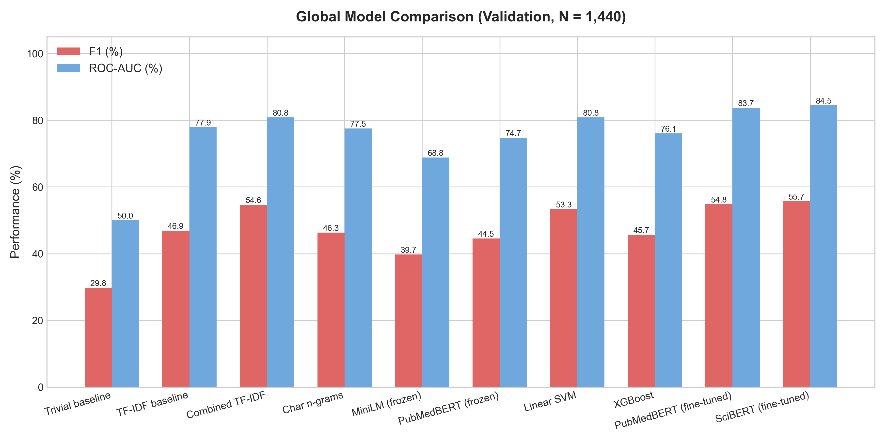
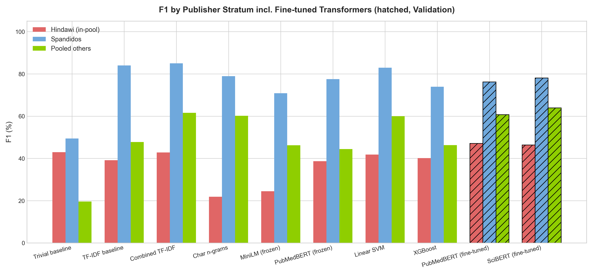
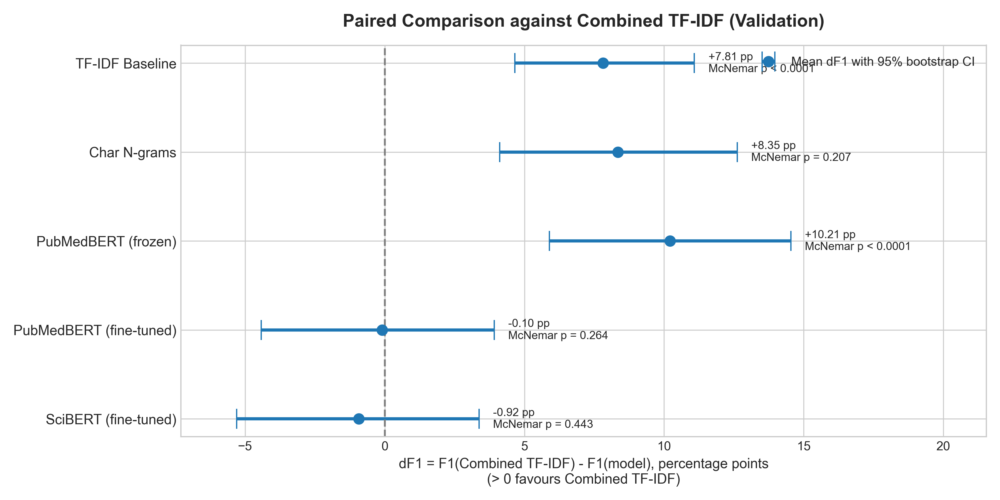
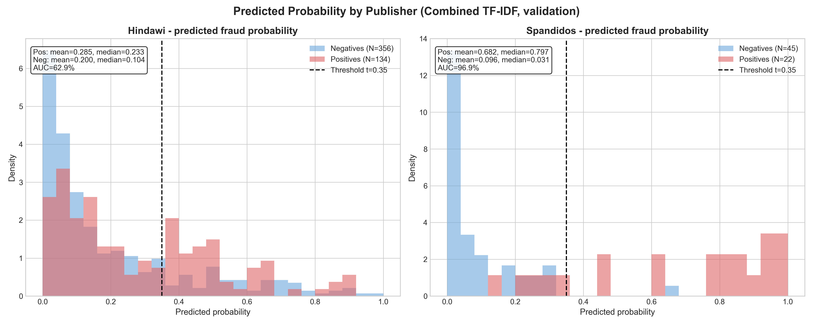

# The Semantic Ceiling: Assessing the Limits of NLP for Scientific Publication Fraud Detection in Biomedical Publishing

Research code, results and dataset documentation (**CPM-11K**) accompanying the thesis chapter of the same name ([`docs/THESIS_CHAPTER.md`](docs/THESIS_CHAPTER.md)).

> **Status:** research artifact. Not a maintained production tool.

## Core finding

Text-only classifiers (title + abstract) detect paper-mill articles well when the fraud lives in the **content** (Spandidos: stereotyped texts wrapped around duplicated images, validation F1 = 85%, AUC = 97%), but stay close to chance when the fraud lives in the **editorial process** (Hindawi: compromised peer review, AUC 63–67% for every model). Fine-tuning domain transformers (PubMedBERT, SciBERT) does not move this ceiling: they are statistically indistinguishable from a tuned TF-IDF logistic regression on validation F1, and none of the models beats a trivial "always positive" classifier on the withheld Hindawi holdout by a meaningful margin. Detecting process fraud is likely to need signals outside the text, such as publication metadata, co-authorship and reviewer networks.

Every number below is read from a JSON file in [`results/`](results/) that is written by a script in [`scripts/`](scripts/). [`AUDIT.md`](AUDIT.md) lists which script produces which number and records the corrections made during the audit.

---

## Results

### Validation set (N = 1,440 · 252 positives / 1,188 negatives)

Model selection, thresholds and significance tests use this split only. Each model's decision threshold is its F1-optimal value on validation, searched over [0.10, 0.89].

| Model | Threshold | Precision | Recall | F1 | ROC-AUC |
|---|:---:|:---:|:---:|:---:|:---:|
| Trivial baseline (always positive) | — | 17.50% | 100.00% | 29.79% | 50.00% |
| TF-IDF baseline (min_df=2, C=1.0) | 0.37 | 36.30% | 66.27% | 46.91% | 77.86% |
| Character n-grams (char_wb 3–5) | 0.55 | 46.25% | 46.43% | 46.34% | 77.49% |
| MiniLM-L6-v2 embeddings (frozen) + LR | 0.55 | 33.70% | 48.41% | 39.74% | 68.83% |
| S-PubMedBert embeddings (frozen) + LR | 0.54 | 36.46% | 57.14% | 44.51% | 74.71% |
| XGBoost (TF-IDF, min_df=5) | 0.33 | 37.04% | 59.52% | 45.66% | 76.08% |
| Linear SVM (TF-IDF, min_df=5) | −0.20¹ | 47.52% | 60.71% | 53.31% | 80.83% |
| **Combined TF-IDF (min_df=5, C=15.0)** | **0.35** | **49.68%** | **60.71%** | **54.64%** | **80.85%** |
| PubMedBERT (fine-tuned, 3 epochs) | 0.28 | 47.26% | 65.08% | 54.76% | 83.72% |
| SciBERT (fine-tuned, 3 epochs) | 0.23 | 51.70% | 60.32% | 55.68% | 84.47% |

¹ Threshold on the SVM decision function.

#### Publisher-stratified (F1 / ROC-AUC)

Global metrics hide the main result, so stratified reporting is mandatory for this dataset. Validation strata: Hindawi 134/356, Spandidos 22/45, Others 96/787 (positives/negatives).

| Model | Hindawi | Spandidos | Others |
|---|:---:|:---:|:---:|
| Trivial baseline | 42.95% / 50.00% | 49.44% / 50.00% | 19.61% / 50.00% |
| TF-IDF baseline | 39.15% / 61.20% | 84.00% / 96.26% | 47.77% / 93.49% |
| Character n-grams | 21.89% / 60.73% | 78.95% / 93.64% | 60.15% / 92.65% |
| MiniLM (frozen) | 24.47% / 52.81% | 70.83% / 86.57% | 46.20% / 85.10% |
| PubMedBERT (frozen) | 38.69% / 58.92% | 77.55% / 89.09% | 44.44% / 86.13% |
| XGBoost | 40.15% / 61.83% | 73.91% / 91.41% | 46.29% / 88.85% |
| Linear SVM | 41.83% / 63.54% | 82.93% / 96.87% | 60.00% / 92.52% |
| **Combined TF-IDF** | **42.80% / 62.93%** | **85.00% / 96.87%** | **61.60% / 92.91%** |
| PubMedBERT (fine-tuned) | 47.10% / 65.40% | 76.19% / 94.95% | 60.73% / 93.50% |
| SciBERT (fine-tuned) | 46.37% / 66.62% | 78.05% / 96.06% | 63.89% / 93.44% |

Combined TF-IDF bootstrap 95% CIs (2,000 resamples): Hindawi F1 [34.98%, 50.18%], AUC [57.94%, 68.36%]; Spandidos F1 [70.97%, 95.45%], AUC [92.63%, 99.63%]; Others F1 [54.34%, 67.95%], AUC [89.55%, 95.83%]. On Hindawi, Combined TF-IDF (42.80%) is 0.15 pp *below* the trivial baseline (42.95%).

### Statistical significance (validation, reference = Combined TF-IDF)

McNemar's test with continuity correction, Holm–Bonferroni adjustment over the five comparisons, and a 2,000-iteration paired bootstrap of ΔF1 = F1(Combined TF-IDF) − F1(model), so a positive ΔF1 favours Combined TF-IDF.

| Compared model | McNemar χ² | p | Holm p | ΔF1 mean | ΔF1 95% CI |
|---|:---:|:---:|:---:|:---:|:---:|
| TF-IDF baseline | 76.41 | 2.3 × 10⁻¹⁸ | 1.2 × 10⁻¹⁷ | +7.81 pp | [+4.66, +11.08] |
| Character n-grams | 1.59 | 0.207 | 0.622 | +8.35 pp | [+4.12, +12.62] |
| PubMedBERT (frozen) | 40.51 | 2.0 × 10⁻¹⁰ | 7.8 × 10⁻¹⁰ | +10.21 pp | [+5.89, +14.54] |
| PubMedBERT (fine-tuned) | 1.25 | 0.264 | 0.622 | −0.10 pp | [−4.42, +3.91] |
| SciBERT (fine-tuned) | 0.59 | 0.443 | 0.622 | −0.92 pp | [−5.30, +3.38] |

- Combined TF-IDF is significantly better than the TF-IDF baseline and frozen PubMedBERT on both tests.
- Against character n-grams the tests disagree. McNemar finds no difference in paired errors, but the F1 bootstrap does, because Combined TF-IDF reaches much higher recall at similar precision (thesis §4.3).
- The fine-tuned transformers are **not** distinguishable from Combined TF-IDF: neither test is significant and both ΔF1 intervals include 0.

### Test set (N = 1,440 · 252 / 1,188; accessed once, thresholds frozen beforehand)

Common threshold t = 0.35, the value frozen for Combined TF-IDF. Test strata: Hindawi 134/357, Spandidos 18/43, Others 100/788.

| Model | Global F1 / AUC | Hindawi F1 / AUC | Spandidos F1 / AUC | Others F1 / AUC |
|---|:---:|:---:|:---:|:---:|
| Combined TF-IDF | 49.45% / 79.60% | 38.98% / 65.78% | 81.25% / 97.16% | 54.61% / 89.21% |
| PubMedBERT (fine-tuned) | 49.24% / 81.83% | 37.74% / 66.06% | 87.50% / 94.57% | 57.14% / 90.09% |
| SciBERT (fine-tuned) | 50.85% / 83.83% | 36.36% / 70.42% | 77.42% / 92.89% | 63.11% / 90.75% |

At their own validation thresholds (0.28 / 0.23) the transformers reach test F1 48.52% (PubMedBERT) and 52.35% (SciBERT); AUC is unchanged. See `results/finetuned_test_results.json`.

### Hindawi holdout (N = 1,504 · 429 / 1,075; fully withheld)

| Model | Threshold | Precision | Recall | F1 | ROC-AUC |
|---|:---:|:---:|:---:|:---:|:---:|
| Trivial baseline (always positive) | — | 28.52% | 100.00% | **44.39%** | 50.00% |
| Combined TF-IDF | 0.35 | 46.18% | 35.20% | 39.95% | 64.18% |
| PubMedBERT (fine-tuned) | 0.35 | 43.58% | 41.96% | 42.76% | 67.48% |
| SciBERT (fine-tuned) | 0.35 | 46.30% | 34.97% | 39.84% | 66.77% |
| PubMedBERT (fine-tuned) | 0.28 (own) | 42.64% | 45.22% | 43.89% | 67.48% |
| SciBERT (fine-tuned) | 0.23 (own) | 44.52% | 44.52% | 44.52% | 66.77% |

At the common threshold no model reaches the trivial baseline. At its own threshold SciBERT exceeds it by 0.13 pp, which is not a meaningful improvement. Ranking quality stays at AUC 64–68%.

### Figures

| Global comparison (validation) | Stratified F1 incl. fine-tuned models |
|:---:|:---:|
|  |  |
| **Paired ΔF1 vs Combined TF-IDF** | **Predicted probabilities, Hindawi vs Spandidos** |
|  |  |

All 15 figures are in [`docs/figures/`](docs/figures/) and are regenerated by the scripts in `scripts/viz/`.

---

## Why Hindawi fails: supporting analyses

- **Retraction reasons** (RWDB, matched by DOI, train + validation positives). Spandidos: 76.6% image duplication (239/312), 0% peer-review manipulation. Hindawi: 100% compromised peer review (291/291), 61.9% computer-generated content (180/291), 0% image duplication.
- **Dose-response check.** Hindawi validation positives are split into subgroup A (computer-generated content, N = 82) and subgroup B (other process fraud, N = 52), each scored against all 356 Hindawi negatives. AUCs are statistically indistinguishable: Combined TF-IDF 62.89% vs 62.98%, frozen PubMedBERT 59.41% vs 58.14%, with fully overlapping CIs. Machine-generated rewording is therefore not what hides the signal.
- **Label-permutation test** (50 seeds). Under permuted labels, validation F1 is 19.39% ± 2.19% and AUC 50.38%. The observed values (54.64% / 80.85%) lie 16.1 and 14.2 standard deviations above them; 0/50 permutations reach them.

## The 100% AUC artifact (thesis §5.8)

An early version of the dataset (v1) gave every fine-tuned model a perfect AUC of 100%. The cause was formatting: PubMed titles (the negatives) end with a period and RWDB-sourced titles (the positives) do not, so the transformers learned the final token. The canonical v2 dataset strips trailing `.`, `;` and spaces from every title (`scripts/data_build/strip_title_punctuation.py`; abstracts are untouched). After retraining, performance fell to the values above, and the PubMedBERT/SciBERT AUCs on the "pure process fraud" subgroup fell from 100% to 62.54% / 66.44%. The v1 diagnostics are kept in [`archive/`](archive/).

---

## Dataset: CPM-11K

| Split | Positives | Negatives | Total |
|---|:---:|:---:|:---:|
| Train | 1,178 | 5,544 | 6,722 |
| Validation | 252 | 1,188 | 1,440 |
| Test | 252 | 1,188 | 1,440 |
| Hindawi holdout | 429 | 1,075 | 1,504 |
| **Total** | **2,111** | **8,995** | **11,106** |

- **Positives:** oncology papers retracted for paper-mill activity, taken from the Retraction Watch Database (RWDB), with their original pre-retraction abstracts from PubMed (2,069) or Crossref (42).
- **Negatives:** PubMed oncology papers matched on journal and year (±1). Reviews, letters, editorials and similar publication types are excluded.
- **Class ratio** is 1 : 4.26. Publication years run from 2011 to 2023; the 41 records from 2024–2025 were excluded because retractions of recent papers are still under-reported.
- **Splitting is group-aware.** Records sharing ≥ 2 authors, or with same-journal titles at character-3-gram Jaccard ≥ 0.7, are kept in the same split. Single-author linking was rejected because common surnames chained 979 records into one cluster.
- **Hindawi holdout:** 50% of Hindawi records, stratified by year, are withheld entirely.

Record schema (`data/processed/cancer_pm_*.json`): `doi`, `pmid`, `title`, `abstract`, `journal` (NLM abbreviation), `year`, `label` (1 = paper mill, 0 = control), `abstract_source` (`PubMed` / `Crossref`), `oncology_verified`.

Full methodology, purge rates, per-split publisher and year tables, and known limitations: [`docs/DATASET_CARD.md`](docs/DATASET_CARD.md).

---

## Reproducing the results

```bash
git clone https://github.com/0khacha/cancer-paper-mill.git
cd cancer-paper-mill
pip install -r requirements.txt
```

**Data.** The dataset files are not distributed (they derive from the licensed RWDB). To run the pipeline you need:

- `data/raw/rwdb/retraction_watch.csv`, the RWDB export, which you can request from the [Center for Scientific Integrity](https://retractionwatch.com/retraction-watch-database-user-guide/);
- `data/processed/cancer_pm_{dataset,train,val,test,holdout}.json` and `journal_to_nlm.json`, the CPM-11K files.

**Models.** `models/tfidf_combined.joblib` is versioned. The fine-tuned checkpoints (`models/{pubmedbert,scibert}_epoch_3.pt`, ~440 MB each) are not; regenerate them with `finetune_transformer.py`. Hugging Face models are loaded with `local_files_only=True`, so download them once beforehand.

All scripts resolve paths from the repository root and can be run from any directory.

```bash
# 1. Combined TF-IDF: validation-only C sweep, training, evaluation
python scripts/train/exhaustive_search.py           # -> results/hyperparameter_sweep_full.json (selects C=15, t=0.35)
python scripts/train/train_tfidf_combined.py        # -> models/tfidf_combined.joblib
python scripts/eval/eval_tfidf_combined.py          # -> results/tfidf_combined_results.json

# 2. Other baselines
python scripts/train/train_classical_baselines.py   # SVM, XGBoost -> results/classical_baselines_results.json
python scripts/eval/eval_frozen_embeddings.py       # MiniLM, S-PubMedBert -> results/frozen_embeddings_results.json

# 3. Fine-tuned transformers (GPU recommended)
python scripts/train/finetune_transformer.py --model pubmedbert
python scripts/train/finetune_transformer.py --model scibert

# 4. Significance, final test/holdout evaluation, Hindawi analyses
python scripts/eval/significance_testing.py         # -> results/significance_results.json
python scripts/eval/eval_final_test.py              # -> results/finetuned_test_results.json
python scripts/eval/hindawi_analysis.py             # -> results/hindawi_analysis_results.json

# 5. Figures -> docs/figures/
python scripts/viz/plot_hyperparameter_sweep.py
python scripts/viz/generate_eda_figures.py
python scripts/viz/generate_final_eval_figures.py
python scripts/viz/generate_analysis_figures.py
```

Frozen-embedding and fine-tuned scores are cached in `models/embeddings/` and `models/predictions/` (git-ignored); delete them to force recomputation.

**Dataset construction** (`scripts/data_build/`). `generate_negatives.py` → `validate_negatives.py` → `fetch_abstracts.py` → `split_dataset.py` → `strip_title_punctuation.py` write `data/interim/` and then `data/processed/`. These scripts query PubMed/Crossref and are included for transparency. They cannot be re-run end-to-end from this repository: their input `data/interim/clean_positives.json` (the RWDB paper-mill selection) and the journal → NLM map were produced by steps that are not versioned, and the live APIs return different results over time. `normalize_abstracts.py` builds the `*_normalized.json` files used only by the formatting-artifact ablation (thesis §5.9).

---

## Repository structure

```
├── README.md · AUDIT.md · LICENSE · requirements.txt
├── docs/
│   ├── THESIS_CHAPTER.md        thesis chapter (English)
│   ├── DATASET_CARD.md          dataset methodology and limitations
│   ├── figures/                 15 figures, all script-generated
│   └── audit_logs/              console logs of the result-generating runs
├── results/                     every reported number (JSON)
│   └── exploratory_training_volume/   exploratory, not part of the main protocol
├── models/
│   └── tfidf_combined.joblib    canonical Combined TF-IDF (other checkpoints git-ignored)
├── scripts/
│   ├── common.py                shared paths, data loading, publisher strata, metrics
│   ├── data_build/              dataset construction (see above)
│   ├── train/                   exhaustive_search, train_tfidf_combined, train_classical_baselines, finetune_transformer
│   ├── eval/                    eval_tfidf_combined, eval_frozen_embeddings, significance_testing,
│   │                            eval_final_test, hindawi_analysis, exploratory_hindawi_training_volume
│   └── viz/                     figure generation
├── data/                        git-ignored: raw/ (RWDB), interim/, processed/ (CPM-11K)
└── archive/                     v1 (pre-fix) diagnostics and results kept for the §5.8 audit trail
```

`scripts/eval/exploratory_hindawi_training_volume.py` retrains Combined TF-IDF on train + holdout to test whether more Hindawi data helps. Validation/test Hindawi F1 rises to 43.70% / 47.62% (trivial baseline 42.95% / 42.88%; AUC 69.8% / 71.5%). It is exploratory: the holdout is consumed for training, so the result must not be compared with the holdout numbers above.

## Attribution

- **Retraction Watch Database:** positive labels and retraction reasons, courtesy of the [Center for Scientific Integrity](https://retractionwatch.com/); use is subject to their terms.
- **MEDLINE/PubMed** (NLM, via the Entrez E-utilities) and **Crossref**: article metadata and abstracts.
- Pre-trained models: `microsoft/BiomedNLP-BiomedBERT-base-uncased-abstract-fulltext`, `allenai/scibert_scivocab_uncased`, `pritamdeka/S-PubMedBert-MS-MARCO`, `sentence-transformers/all-MiniLM-L6-v2`.

## License

MIT — see [LICENSE](LICENSE).
