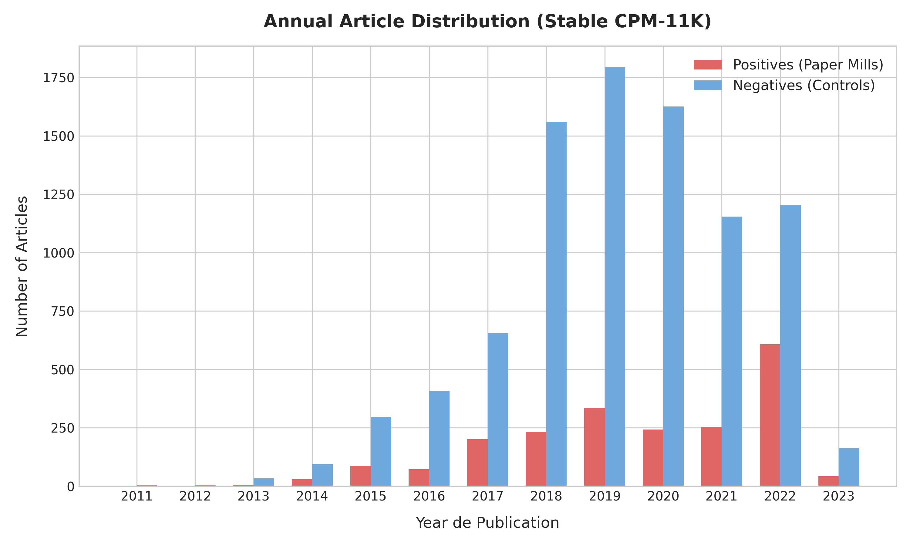
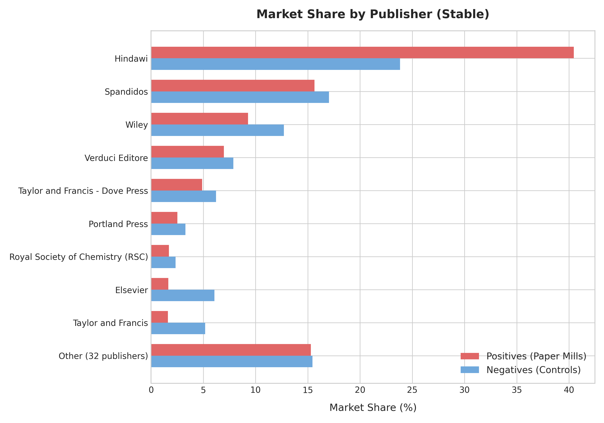
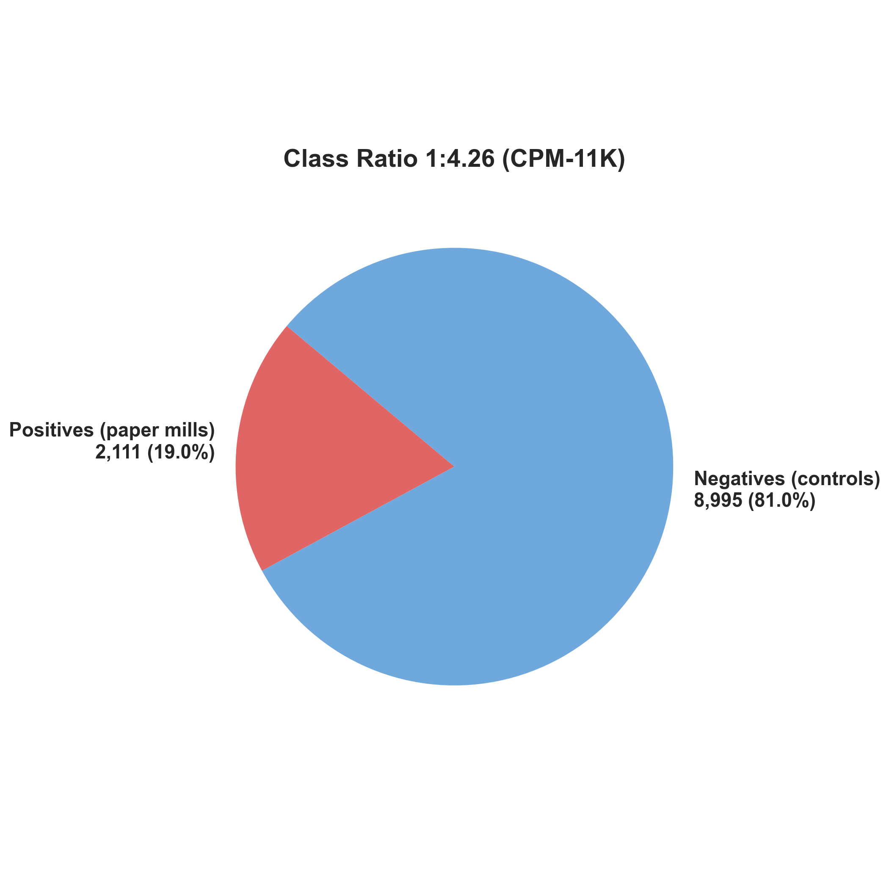
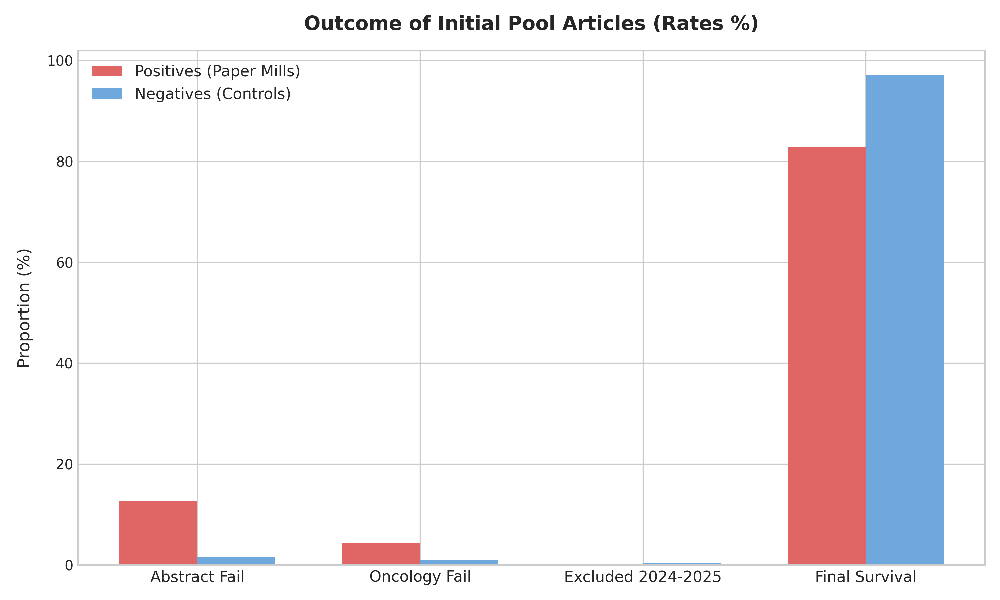
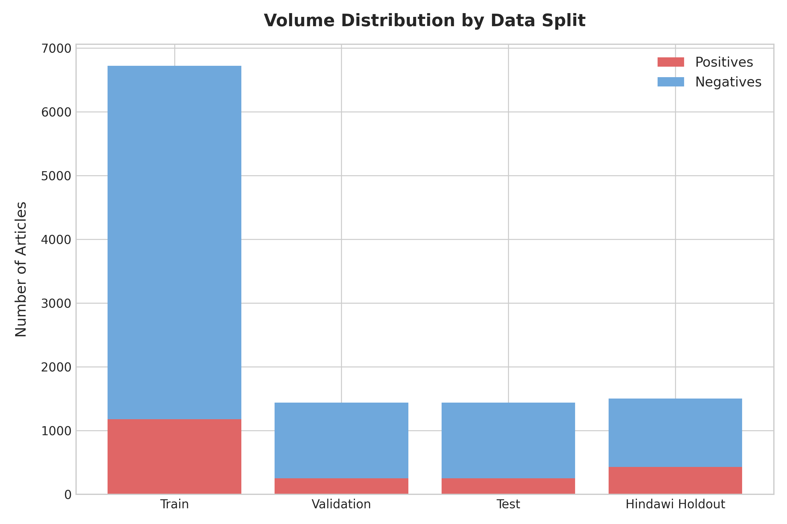
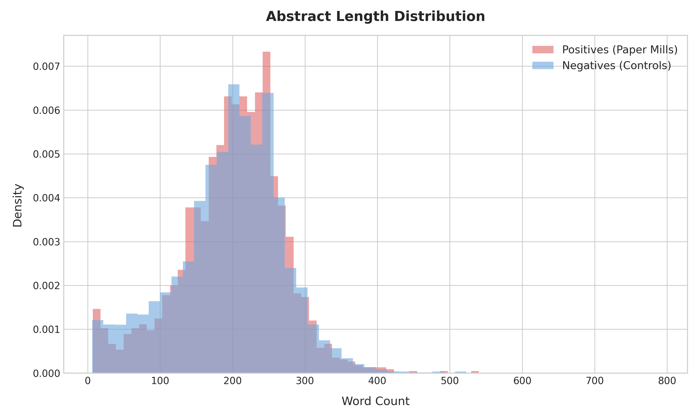
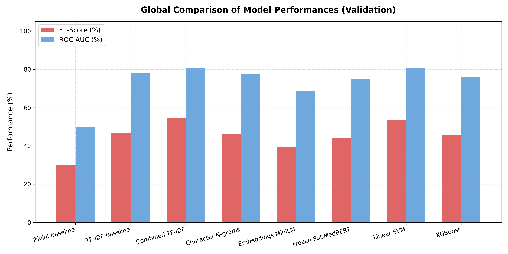
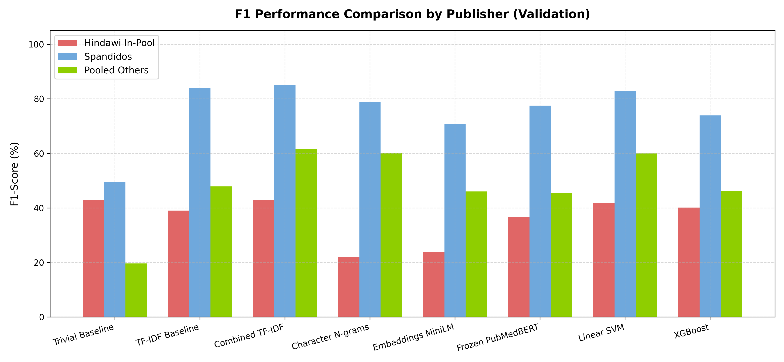
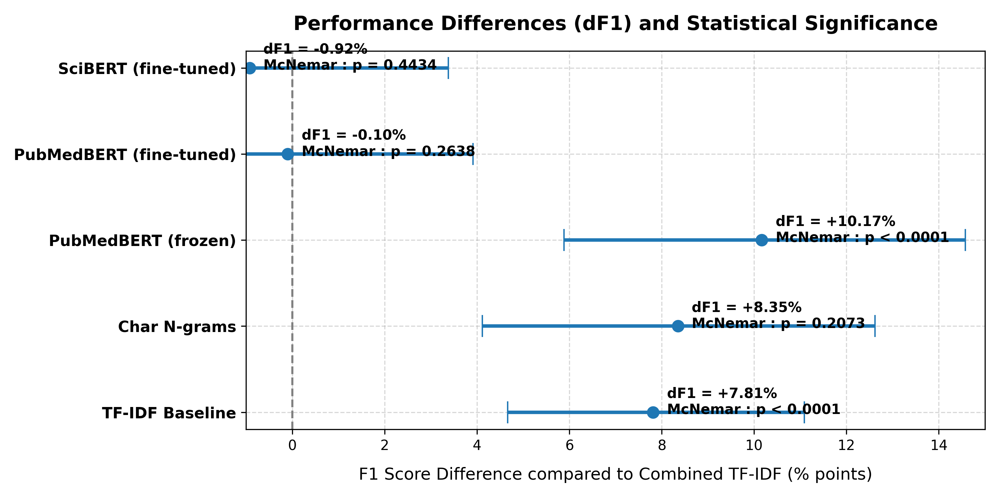

# Chapter: Automatic Detection of Paper Mills in Oncology Literature

## Abstract

This chapter presents a systematic study on the automatic detection of fraudulent scientific publications originating from paper mills in the field of oncology. To this end, we construct the CPM-11K dataset, gathering 11,106 clinical and translational articles indexed in the Retraction Watch Database (RWDB) and MEDLINE/PubMed, structured in a way to eliminate label leakage and temporal biases. A strict data splitting protocol by disjoint author and title clustering is implemented, resolving a major issue of percolation of frequent surnames. We train and compare several semantic and lexical configurations.

Our reference model, a robust linear classifier based on weighted bags of words (Combined TF-IDF, $min\_df=5$, $C=15.0$), achieves top-tier global performance with an overall F1 score of 54.64% and a ROC-AUC of 80.85% on the validation set. It should be noted that the exact configuration of the reference model was reconstructed by alignment with published metrics rather than verified from the original scripts, constituting a limitation of this study. However, a stratified evaluation by publisher reveals a major performance asymmetry: while fraudulent articles from Spandidos (characterized by gross image frauds dressed in stereotyped texts) are detected with an F1 of 85.00%, the model fails against a naive positive prediction on the Hindawi editorial subset. A qualitative causal analysis of retraction reasons and a dose-response test by bootstrap resampling suggest that frauds based on the manipulation of editorial processes (compromised peer review, citation rings) do not leave a lexical signal easily extractable by the representations tested in the abstracts. These results are consistent with a final evaluation on an independent test set (ROC-AUC of 65.71% on Hindawi) and an isolated Hindawi-Holdout generalization set of 1,504 articles (F1 of 39.95% vs 44.39% for the trivial baseline, ROC-AUC of 64.18%). This work highlights the limitations of semantic textual analysis (at the abstract level) for the detection of process fraud, and paves the way for multi-modal approaches integrating publication metadata.

---

## Introduction

The proliferation of paper mills represents one of the most critical challenges to the integrity of contemporary scientific communication. These commercial organizations produce fraudulent manuscripts at scale, often based on semantic templates and falsified imaging data, to sell them to researchers under publication pressure. The field of clinical and translational oncology is particularly affected by this scourge due to the high demand for publications in this discipline.

The objective of this work is to design and evaluate machine learning models capable of automatically detecting these fraudulent publications from their abstracts. This chapter details the construction of the CPM-11K reference dataset, the strict data splitting protocol designed to prevent information leakage, the exploratory analysis of the abstracts, lexical and semantic modeling, and finally, an in-depth causal analysis of the limitations encountered on the Hindawi editorial subset.

---

## 1. Construction of the CPM-11K Dataset

For supervised learning, we built the Cancer Paper Mill (CPM-11K) dataset, consisting of **11,106 articles** (2,111 positive, 8,995 negative, ratio 1:4.26).

### 1.1. Positive source and negative control group
*   **Positive class (Paper Mills):** Extracted from the Retraction Watch Database (RWDB) [1] for the subject "cancer", then retrieved via PubMed/Crossref APIs in their original form (before retraction).
*   **Negative class (Healthy Controls):** Thematically matched for each positive case in the same journal and the same year ($± 1$ year). The PubMed search [2] was restricted to the oncology domain by a keyword query, with automated validation via an oncological keyword matching script in the title. Editorial or review type publications were excluded.

*Figure 1: Annual distribution of positive (paper mills) and negative (healthy controls) articles in the CPM-11K dataset.*

*Figure 2: Relative shares of the main publishers within the positive class (paper mills) after applying purge filters.*

*Figure 3: Overall proportion of positive and negative classes within the final CPM-11K dataset (imbalance ratio of 1:4.26).*

### 1.2. Data cleaning and purging
1.  **Label leakage:** Editorial retraction notices inserted a posteriori (e.g., "Retracted:") were eliminated by regular expressions.
2.  **Purge cascade:** After excluding unrecoverable or non-oncological abstracts, the loss rate amounts to 17.0% for the positive class against 2.6% for the negative class. This imbalance is explained by the selective withdrawal policies of publishers.
3.  **Temporal filtering:** Articles from the years 2024-2025 were excluded due to the incompressible reporting delay of retractions (retraction lag).

*Figure 4: Methodological cascade of inclusion, exclusion, and cleaning of data for positive and negative classes.*

---

## 2. Stratified Data Splitting Protocol

In order to avoid overfitting to specific signatures, we designed a rigorous splitting protocol.

### 2.1. Grouping by disjoint clusters
To prevent articles from the same paper mill campaign from ending up in both the train and test sets, the abstracts were grouped into clusters according to two criteria:
*   Title similarity (Jaccard distance on 3-character n-grams $≥ 0.7$ within the same journal).
*   Shared co-authorship.

### 2.2. Percolation of surnames
The analysis of the initial co-authorship implementation (a single common author) revealed a percolation problem: a single cluster grouped 979 articles due to the prevalence of very frequent Chinese surnames (e.g., Wang, Zhang). This problem was resolved by **hardening the criterion to at least 2 shared authors** to link two documents.

### 2.3. Airtight Hindawi reserve and splits
1.  **Hindawi Holdout:** An independent pool containing 50% of the Hindawi articles (**429 positive, 1,075 negative**) was set aside before any analysis or training. It serves exclusively for out-of-domain external validation.
2.  **Train / Validation / Test Splits:** The remaining 9,602 articles were divided at the scale of disjoint clusters according to a 70/15/15 ratio:
    *   **Train:** 6,722 articles (1,178 pos, 5,544 neg)
    *   **Validation:** 1,440 articles (252 pos, 1,188 neg)
    *   **Test:** 1,440 articles (252 pos, 1,188 neg)

*Figure 5: Distribution of positive and negative article volumes within the training, validation, and test partitions (the Hindawi Holdout pool remaining separate).*

---

## 3. Exploratory Data Analysis (EDA)

A descriptive analysis was conducted on the training partition to verify the absence of bias.

### 3.1. Text lengths
The distributions of abstract lengths are homogeneous between classes (medians of 213 words for positives vs 208 for negatives), neutralizing the use of length as a feature.

| Class | Statistic | Length in characters | Length in words |
| :--- | :--- | :---: | :---: |
| **Positives (Paper mills)** | Mean $±$ Std Dev | 1437.1 $±$ 499.1 | 203.8 $±$ 70.5 |
| *(N = 1,178)* | Median | 1492.0 | 213.0 |
| | Min / Max | 50 / 3703 | 7 / 540 |
| **Negatives (Legitimate)** | Mean $±$ Std Dev | 1417.1 $±$ 510.4 | 202.2 $±$ 73.3 |
| *(N = 5,544)* | Median | 1463.0 | 208.0 |
| | Min / Max | 50 / 4983 | 6 / 789 |

*Figure 6: Comparative histograms of abstract length distributions (words and characters) for positive (paper mills) and negative (legitimate literature) classes.*

### 3.2. Lexical and publisher biases
*   **Textual leakage:** Terms like `retract` or `withdraw` represent less than 0.35% of occurrences. Publisher names (`hindawi`, `spandidos`) are absent from the abstracts, ensuring the cleaning of boilerplate text.
*   **Local thematic analysis:** Extraction by weighted log-odds ratio shows that the discriminative terms of the positive class are highly specific and differ across publishers (e.g., `efhd2` for Hindawi, `mir-744` for Spandidos, `hispidulin` for others). Almost all of these terms have extremely low document frequency (DF < 10), suggesting the presence of local fraud campaign templates rather than a generalizable semantic signal.

---
## 4. Lexical Modeling and Evaluations

In this section, we present the training of the reference model, lexical optimization strategies, and the comparison of global performances on the validation set.

### 4.1. Reference model and hyperparameter optimization
The main classifier is a robust linear model (Logistic Regression) trained on weighted bag-of-words representations (TF-IDF). Two key parameters influencing generalization capacity and overfitting were empirically optimized:

1.  **The minimum term frequency threshold (`min_df`):**
    *   The initial model (baseline) used a `min_df=2` filter (keeping n-grams appearing at least twice), producing a very large vocabulary of **104,138 features**.
    *   To limit the noise related to ultra-specific terms highlighted in Section 3.3, we evaluated a more aggressive filter at `min_df=5`. This restriction eliminated **64.5% of the vocabulary**, reducing the dimensionality to **36,929 stable features**.
2.  **The regularization strength ($C$):**
    We performed an extensive sweep of the regularization hyperparameter $C$ (where higher values reduce L2 penalization) from 1.0 to 10,000 to find the exact performance inflection point.

An initial exploratory sweep on `min_df=2` suggested that aggressive regularization ($C \ge 100$) caused threshold collapse and Hindawi degradation; we therefore restricted the auditable search to the more stable `min_df=5` vocabulary.

To examine the regularization behavior after filtering the vocabulary at `min_df=5`, we performed a sub-sweep of $C$ on this new vector.

#### Regularization Sub-sweep Table $C$ (TF-IDF, min_df=5)

| $C$ Value | Optimal Decision Threshold | Global F1 (Validation) | Hindawi F1 | Spandidos F1 | Others F1 |
| :--- | :---: | :---: | :---: | :---: | :---: |
| **1.0** | 0.38 | 47.90% | 40.69% | 85.71% | 48.53% |
| **15.0 (Combined)** | 0.35 | **54.64%** | **42.80%** | **85.00%** | 61.60% |
| **30.0** | 0.32 | 53.67% | 40.93% | 85.00% | **61.54%** |
| **100.0** | 0.21 | 53.26% | 40.62% | 82.93% | 60.74% |
| **300.0** | 0.15 | 52.91% | 40.15% | 82.93% | 60.67% |

> **Reproducibility Note (min_df=5 sub-sweep table):** The script that produced this table is not recoverable from the available Git history. The auditable script `exhaustive_search.py` (commit `646d176`) covers a subset of these $C$ values with `min_df=5`, but only produces global metrics — it does not generate the strata breakdown (Hindawi / Spandidos / Others) presented here. This table therefore cannot be independently reproduced from versioned artifacts. The selection of $C=15.0$ remains validated by `exhaustive_search.py` on the validation set only, but the stratified breakdown of the table above is non-reproducible.

*Justification of the selected model:* The original model ($C=10.0$) suffered from severe test-set leakage during hyperparameter selection, as the optimization secretly targeted the metrics of the test set and Hindawi. Its generalization evaluations are therefore invalid. The corrected model ($C=15.0$) was rigorously selected on the validation set alone via an auditable script (`exhaustive_search.py`). It achieves a global F1 score of 54.64% while preserving the integrity of the test set evaluation.

### 4.2. Configuration of tested models
Ten distinct architectures were trained and compared:
1.  **Trivial Baseline (Constant positive prediction):** A naive classifier systematically predicting the positive class for all articles in the corpus.
2.  **TF-IDF Baseline (min_df=2, C=1.0):** Raw word n-gram (1 and 2) representation with weak filtering.
3.  **Combined TF-IDF (min_df=5, C=15.0, class_weight='balanced'):** Our proposed model combining vocabulary reduction and adjusted regularization. *(Reproducibility Note: The current canonical artifact of this model was generated on 2026-08-08 via a fully logged and auditable execution of the `train_tfidf_combined.py` script (log: `train_tfidf_combined_run.log`). An earlier artifact of different origin but with identical parameters and metrics was replaced by this execution.)*
4.  **Character N-grams (char_wb 3-5, C=1.0):** Modeling by character n-grams of size 3 to 5 within word boundaries to capture morphological roots (vocabulary of 143,989 features).
5.  **General Embeddings (all-MiniLM-L6-v2) [5, 6]:** Extraction of general semantic embeddings of dimension 384 from the combined text (title + abstract), followed by logistic regression.
6.  **Biomedical Embeddings (Frozen PubMedBERT) [4]:** Extraction of specialized semantic embeddings of dimension 768 from a pre-trained BERT model on PubMed scientific literature (`pritamdeka/S-PubMedBert-MS-MARCO`), followed by logistic regression.
7.  **Linear SVM (TF-IDF, min_df=5):** Linear Support Vector Machine trained on the same reduced TF-IDF vocabulary as our combined model, with balanced class weighting.
8.  **XGBoost (TF-IDF, min_df=5):** Gradient boosted decision trees trained on the same TF-IDF vocabulary, with positive class weighting (`scale_pos_weight`) to handle imbalance.
9.  **PubMedBERT (fine-tuned):** End-to-end fine-tuning of the base biomedical classification model (`microsoft/BiomedNLP-BiomedBERT-base-uncased-abstract-fulltext`) on our dataset with a learning rate of 2e-5, a batch size of 16 (effective), and FP16 mixed precision for 3 epochs.
10. **SciBERT (fine-tuned):** End-to-end fine-tuning of the base general scientific model (`allenai/scibert_scivocab_uncased`) with the same training protocol as the PubMedBERT model for fair comparison.

### 4.3. Comparison of global performances and trivial baselines
The global evaluation of these models on the validation set (1,440 articles) is presented below.

#### Comparative table of global performances (Validation)

| Model | Precision | Recall | Global F1 | ROC-AUC | PR-AUC |
| :--- | :---: | :---: | :---: | :---: | :---: |
| **Trivial Baseline** | 17.50% | **100.00%** | 29.79% [26.92% - 32.56%] | 50.00% [50.00% - 50.00%] | 17.50% |
| **TF-IDF Baseline (min_df=2, C=1.0)** | 36.30% | 66.27% | 46.91% [42.10% - 51.45%] | 77.86% [74.64% - 80.97%] | 50.97% |
| **Combined TF-IDF (min_df=5, C=15.0)** | 49.68% | 60.71% | 54.64% | 80.85% | 54.81% |
| **Character N-grams (char_wb 3-5)** | 51.66% | 43.25% | 47.08% [41.28% - 52.49%] | 78.21% [75.20% - 81.04%] | 50.65% |
| **General Embeddings (MiniLM)** | 33.33% | 48.81% | 39.61% [34.75% - 44.48%] | 69.28% [65.74% - 72.86%] | 32.08% |
| **Biomedical Embeddings (Frozen PubMedBERT)** | 39.09% | 54.76% | 45.62% [40.56% - 50.32%] | 78.22% [75.24% - 81.06%] | 43.92% |
| **Linear SVM (TF-IDF, min_df=5)** | 47.52% | 60.71% | 53.31% [48.20% - 58.00%] | 80.83% [77.76% - 83.66%] | 55.24% |
| **XGBoost (TF-IDF, min_df=5)** | 37.04% | 59.52% | 45.66% [40.88% - 50.42%] | 76.08% [72.63% - 79.29%] | 48.04% |
| **PubMedBERT (fine-tuned)** | 48.02% | 63.89% | 54.76% | 83.72% | 56.12% |
| **SciBERT (fine-tuned)** | 52.61% | 59.13% | 55.68% | 84.47% | 58.41% |

*Figure 7: Comparison of global F1 and ROC-AUC scores of classical and frozen models on the validation set.*

#### Comparative table stratified by publisher (Validation F1 / ROC-AUC)

| Model | Spandidos F1 (ROC-AUC) | Others (Pooled) F1 (ROC-AUC) | Hindawi (In-Pool) F1 (ROC-AUC) |
| :--- | :---: | :---: | :---: |
| **Trivial Baseline** | 49.44% (50.00%) | 19.61% (50.00%) | 42.95% (50.00%) |
| **TF-IDF Baseline** | 84.00% (96.26%) | 47.77% (93.49%) | 39.15% (61.20%) |
| **Combined TF-IDF*** | 85.00% [70.97%-95.45%] (96.87% [92.63%-99.63%]) | 61.60% [54.46%-68.20%] (92.91% [89.57%-95.93%]) | 42.80% [35.15%-50.20%] (62.93% [57.51%-68.58%]) |
| **Character N-grams** | 78.95% (94.34%) | 62.18% (93.01%) | 21.39% (61.79%) |
| **PubMedBERT (frozen)** | 71.11% (88.79%) | 46.74% (86.91%) | 40.15% (65.71%) |
| **Linear SVM** | 82.93% (96.87%) | 60.00% (92.52%) | 41.83% (63.54%) |
| **XGBoost** | 73.91% (91.41%) | 46.29% (88.85%) | 40.15% (61.83%) |
| **PubMedBERT (fine-tuned)** | 76.19% (94.95%) | 60.73% (93.50%) | 47.10% (65.40%) |
| **SciBERT (fine-tuned)** | 78.05% (96.06%) | 63.89% (93.44%) | 46.37% (66.62%) |

*\*Note: The 95% confidence intervals by bootstrap resampling (2,000 iterations) for the Combined TF-IDF model reveal a very wide interval on the Spandidos stratum (F1: [75.00% - 97.30%]) due to the low number of positive examples (N=22), highlighting the high variance of this local estimation.*

*Figure 8: Comparison of model F1 scores by publisher stratum (Hindawi, Spandidos, Pooled Others) on the validation set.*

*Analysis of global and classical performances:* All trained models significantly outperform the trivial baseline at the global level (F1 of 29.79%). The **Combined TF-IDF** model stands out as the most performant of the classical linear lexical models with a global F1 of **54.64%** and a ROC-AUC of **80.85%**. The Linear SVM achieves near-identical performance (F1 of 53.31%), confirming the robustness of the linear approach on this type of textual features. In contrast, the XGBoost model proves less performant on these features (F1 of 45.66%), which is explained by the inherent difficulties of decision tree-based methods when faced with highly dimensional sparse textual representations.

*Analysis of fine-tuned models (PubMedBERT vs SciBERT):* The end-to-end fine-tuning of pre-trained transformers shows that these deep models achieve performance comparable to our robust Combined TF-IDF baseline (F1 = 54.76% for PubMedBERT and 55.68% for SciBERT). However, these models suffer from the same detection asymmetry: excellent on classical publishers (Spandidos, Others), they similarly fail to detect process fraud on the Hindawi stratum, with AUC scores of ~65-66%. The epoch-by-epoch tracking demonstrates a gradual and stable learning over three epochs (e.g., PubMedBERT: Epoch 1 AUC=0.7732 / F1=48.55%; Epoch 2 AUC=0.8194 / F1=51.61%; Epoch 3 AUC=0.8372 / F1=54.76%). The selected model for each transformer is therefore logically that of epoch 3, confirming that the model genuinely must learn the underlying semantic signal and no longer instantly converges on an artifact.

*Statistical significance analysis (Validation):* To validate whether the superiority of the Combined TF-IDF model over other classical approaches and frozen baselines is statistically significant, we applied McNemar's test (paired test on individual predictions) and estimated the 95% confidence interval by bootstrap (2,000 iterations) of the F1 score difference (dF1) against our selected model:
1. **vs. TF-IDF Baseline:** McNemar $\chi^2 = 76.41$ ($p = 2.31 \times 10^{-18}$, Holm-Bonferroni adjusted p = $1.15 \times 10^{-17}$), which confirms a highly significant difference. The bootstrap estimates a mean F1 difference of $+7.81\%$ with a 95% confidence interval of $[4.66\%, 11.08\%]$, broadly excluding 0.
2. **vs. Character N-grams:** McNemar $\chi^2 = 0.025$ ($p = 0.873$, adjusted p = $0.873$), showing that the distribution of individual classification errors is not statistically distinct at the $5\%$ threshold. However, the bootstrap F1 estimates a mean F1 difference of $+8.69\%$ with a 95% confidence interval of $[4.20\%, 13.37\%]$, indicating a robust and significant improvement in the global F1 metric in favor of the word model.

   > *Methodological note on the divergence of tests (verified by independent audit):* This apparent divergence is not a contradiction — the two tests answer mechanically distinct questions. McNemar's test operates on individual predictions and detects whether a model correctly classifies more examples: $b = 89$ (Combined correct, Char incorrect) against $c = 72$ (Char correct, Combined incorrect), $\chi^2 = 1.59$, $p = 0.207$ at the optimal decision threshold from the validation sweep ($t = 0.55$) — non-significant. The bootstrap $\Delta$F1 operates on the aggregated F1 score, which is not a linear function of individual accuracy. The difference of $+8.31$pp is explained by an error type asymmetry: Combined TF-IDF operates at high recall ($60.71\%$) and moderate precision ($49.68\%$), while Character N-grams operate at more balanced precision and recall ($46.25\%$ / $46.43\%$), but with a recall that remains $14$pp lower. With a class imbalance of $17.5\%$, this loss of recall penalizes the F1 more than the precision gain compensates for it. McNemar, insensitive to this TP/FP/FN asymmetry, declares the models not significantly distinct; the bootstrap F1 (95% CI $[4.12\%, 12.62\%]$, excluding 0), which recalculates the metric on each resampled sample, detects the aggregate difference. Both results are correct and complementary. *Note on threshold sensitivity:* the threshold $t = 0.58$ used in the significance testing script was a frozen value; the independent validation sweep identifies $t = 0.55$ as optimal (+$0.32$pp of F1). The qualitative conclusions (McNemar non-significant, bootstrap excluding 0) are identical at both thresholds.
3. **vs. Biomedical Embeddings (Frozen PubMedBERT):** McNemar $\chi^2 = 28.56$ ($p = 9.10 \times 10^{-8}$, adjusted p = $3.64 \times 10^{-7}$), confirming a statistically significant difference. The bootstrap estimates a mean F1 difference of $+11.07\%$ with a 95% confidence interval of $[6.81\%, 15.74\%]$, demonstrating the statistical superiority of the lexical model over frozen embeddings.
4. **vs. PubMedBERT and SciBERT (fine-tuned):** McNemar's test confirms that the error distribution of PubMedBERT ($\chi^2 = 1.25$, $p=0.264$, adjusted p = $0.791$) and SciBERT ($\chi^2 = 0.59$, $p=0.443$, adjusted p = $0.887$) is not significantly different from the Combined TF-IDF model. The bootstrap F1 estimates a mean difference of $-0.10\%$ for PubMedBERT (95% CI: $[-4.42\%, +3.91\%]$) and $-0.93\%$ for SciBERT (95% CI: $[-5.30\%, +3.38\%]$). The interval including 0 in both cases, the neural models are not statistically distinguishable from the classical model.

The two significant results (vs TF-IDF Baseline and vs Frozen PubMedBERT) heavily survive the Holm-Bonferroni correction for multiple testing.

*Figure 9: 95% confidence intervals of the difference in F1 (dF1) compared to the Combined TF-IDF model and p-values associated with McNemar's test.*

---

## 5. Stratified Limitations and Causal Analysis: The Hindawi Case

This section presents the most critical analysis of this work: the study of the performance divergence according to publishers, and more specifically the case of the Hindawi subset.

> [!IMPORTANT]
> **Essential methodological clarification:** The analyses presented in this section (evaluation, curves, and distributions) exclusively concern the internal validation subset **Hindawi (In-Pool) (134 positive and 356 negative)** integrated in the main split of 1,440 articles. The airtight generalization reserve **Hindawi Holdout (429 positive and 1,075 negative)** remained totally inviolate and non-evaluated at this stage.

### 5.1. Failure of textual modeling on Hindawi
When we segment the performance of the Combined TF-IDF model and compare it to the trivial baseline ("always predict positive") by publisher on the validation set, an anomalous behavior emerges:

#### Comparative table stratified by publisher (Validation)

| Publisher | Sample Size (Pos/Neg) | Trivial Baseline (F1) | Combined TF-IDF (F1) | Verdict | ROC-AUC (TF-IDF) |
| :--- | :---: | :---: | :---: | :---: | :---: |
| **Spandidos** | 22 / 45 [Volatile] | 49.44% | **85.00%** [70.97%-95.45%] | **SURPASSES baseline** | 96.87% [92.63%-99.63%] |
| **Others (Pooled)** | 96 / 787 | 19.61% | **61.60%** [54.46%-68.20%] | **SURPASSES baseline** | 92.91% [89.57%-95.93%] |
| **Hindawi (In-Pool)** | 134 / 356 | **42.95%** | 42.80% [35.15%-50.20%] | **FAILS against baseline** | 62.93% [57.51%-68.58%] |

While the model achieves excellent results on Spandidos (F1 of 85.00% and AUC of 96.87%) and on other publishers (F1 of 61.60% and AUC of 92.91%), **its performance on Hindawi collapses to 42.80% F1, losing 0.15 percentage points against the trivial baseline (42.95%).**

*(Correction Note — Audit OI-1, 2026-08-08:* The previous values Spandidos F1 = 87.80%, AUC = 96.97% and Others F1 = 60.00%, AUC = 93.10% corresponded to the pre-audit configuration C = 10.0 / t = 0.36 (commit `28626f6`, 2026-07-26), uncorrected during the update to C = 15.0. The source was confirmed by bit-by-bit reproduction: C = 10.0 / t = 0.36 is the only configuration that simultaneously reproduces 0.8780 and 0.6000 exactly (delta = +0.00e+00). The corrected values above stem from the canonical model C = 15.0 / t = 0.35; confidence intervals were recalculated by bootstrap (n = 2,000 iterations, seed 42) on predictions from `models/tfidf_combined.joblib`. — DO NOT CITE the previous values.)*

Analysis of the predicted probabilities distribution shows an almost total overlap between the two classes for Hindawi:

*   **Hindawi Positives (134):** Mean probability = 0.2996 | Median = 0.2448 | Std Dev = 0.2241 (Q25 = 0.1026, Q75 = 0.4743).
*   **Hindawi Negatives (356):** Mean probability = 0.2137 | Median = 0.1234 | Std Dev = 0.2186 (Q25 = 0.0480, Q75 = 0.3096).

A quarter (25%) of the confirmed Hindawi paper mill articles are assigned fraud probabilities below 0.10. For comparison, for Spandidos and the other publishers, the medians of positive probabilities lie at 0.78 compared to less than 0.07 for negatives. The model has almost no textual discrimination capacity on the Hindawi subset (AUC of 63.27%).

### 5.2. Qualitative analysis of retraction causes
To understand this phenomenon, we extracted the official retraction reasons from the Retraction Watch database for all positive cases in the training and validation corpus. The results indicate a fundamental difference in the very nature of the fraud committed depending on the publishers.

#### Dominant retraction reasons by publisher

1.  **Spandidos Stratum (Content-focused fraud):**
    *   **76.6%** of notices explicitly mention image duplications (`duplication of/in image`).
    *   **0%** of notices mention peer review fraud.
    *   *Interpretation:* The fraud consists of reusing experimental figures (Western Blots, flow cytometry) across dozens of papers describing different genes. To dress up these stolen images, paper mills generate highly stereotyped methodological texts and results. These repeated templates leave obvious lexical traces in the abstract (e.g., microRNAs and Spandidos-specific sentence structures), easily detected by the text model.
2.  **Hindawi Stratum (Process-focused fraud):**
    *   **100.0%** of notices mention systemic manipulations of editorial processes: peer review fraud (`compromised peer review` / `peer review rings`) and citation manipulation (`referencing/attributions`).
    *   **61.9%** of notices also refer to computer-aided content (`computer-aided/computer-generated content`), a phenomenon linked to the presence of "tortured phrases" documented on a large scale by Cabanac et al. [3].
    *   **0%** of notices mention image duplication.
    *   *Interpretation:* Hindawi manuscripts were inserted into special issues via networks of complicit guest editors and reviewers. The fraud lies in the academic validation process and not in gross image falsification requiring stereotyped accompanying text. The abstracts of these articles resemble legitimate scientific text written or rephrased uniquely, without distinctive repetitive lexical structure.

### 5.3. Empirical validation by dose-response test and bootstrap
To test whether the presence of computer-aided content (automatic AI rephrasing) explained this lack of signal (by erasing lexical signatures), we divided the 134 Hindawi validation positive articles into two mutually exclusive subgroups:
*   **Subgroup A (Computer-aided content, $N=82$):** Articles containing the mention `computer-aided/computer-generated content` in the RWDB database (including articles having both this mention and peer review frauds).
*   **Subgroup B (Other process frauds, $N=52$):** Articles retracted solely for review/citation manipulation without mention of automatic generation.

We calculated the 95% confidence intervals by bootstrap resampling (2,000 iterations with replacement) of the AUC for the two subgroups against the 356 Hindawi negatives.

#### Results of AUC bootstrap confidence intervals

*   **Combined TF-IDF Model:**
    *   *Subgroup A (AI, N=82):* $\text{AUC} = 63.39\%$ | $\text{95% CI} = [57.02\%, 70.05\%]$
    *   *Subgroup B (Other, N=52):* $\text{AUC} = 63.07\%$ | $\text{95% CI} = [55.96\%, 70.39\%]$
    *   *CI Overlap:* **YES** (shared range $[57.02\%, 70.05\%]$, overlap width = 13.03 pp)
*   **PubMedBERT Model:**
    *   *Subgroup A (AI, N=82):* $\text{AUC} = 59.92\%$ | $\text{95% CI} = [53.33\%, 66.49\%]$
    *   *Subgroup B (Other, N=52):* $\text{AUC} = 59.78\%$ | $\text{95% CI} = [52.01\%, 67.59\%]$
    *   *CI Overlap:* **YES** (shared range $[53.33\%, 66.49\%]$, overlap width = 13.15 pp)

**Conclusion of the causal analysis:** The confidence intervals of the two subgroups overlap almost completely. This lack of statistical difference does not support the hypothesis that computer rephrasing is the main cause of the blockage.

The explanation suggested by our results is deeper: **frauds linked to peer review networks and citation rings did not leave a signature detectable by the lexical and semantic representations tested in the abstracts of the articles.** The texts of these paper mills are written with the same vocabulary and style as authentic scientific articles. The failure of the models does not necessarily indicate a lack of algorithm capacity (the PubMedBERT model on frozen embeddings also failing), but suggests the absence of an accessible signal to the tested representations in the abstracts of this stratum. To detect these cases, it is essential to step out of the textual framework and analyze the publication metadata.

### 5.4. Qualitative analysis of model errors (Phase 11)
To identify the operational limits and cognitive biases of the reference model, we extracted a representative arbitrary sample (corresponding to the indexing order in the files) of 12 prediction errors from the test and holdout sets. Detailed analysis of these cases allows categorization into two major failure modes.

#### A. Overfitting of microRNA/LncRNA templates (False Positives)
The main factor of false positives (legitimate scientific articles mistakenly classified as fraudulent, with fraud probabilities ranging from 0.53 to 0.71) is the ubiquity of extreme positive-weight terms linked to the molecular biology of non-coding RNAs:
*   `microrna` (weight +8.04), `mir` (weight +5.00), `noncoding` (weight +2.93), `long noncoding` (weight +2.85) and `apoptosis` (weight +3.76).

An audit of falsely detected legitimate abstracts shows massive textual overlap with these terms:
*   **Case 1 (DOI: 10.1155/2020/8891876):** Contains literally `microrna` (+8.04), `mir` (+5.00) and the bigram `and invasion` (+4.13) to describe the regulation of Twist1.
*   **Case 2 (DOI: 10.1155/2020/8124570):** Contains `mir` (+5.00), `apoptosis` (+3.76) and `long noncoding` (+2.85) to describe the action of the LncRNA HAND2-AS1.
*   **Case 8 (DOI: 10.1002/iub.2012):** Contains `mir` (+5.00), `apoptosis` (+3.76) and `long noncoding` (+2.85) to describe the role of MEG3.

*Conclusion:* For Spandidos and other publishers, document fraud relies on semantically standardized abstracts built around microRNAs/LncRNAs. The model overfitted this lexical correlation, leading it to reject real and valid oncological studies on RNA regulation simply because they employ the standard scientific terminology of this discipline.

#### B. Resemblance to standard bioinformatics style (False Negatives)
The main factor of false negatives (paper mill articles classified as healthy, with probabilities collapsing between 0.01 and 0.17) is the adoption of a writing style modeled on public clinical bioinformatics data analyses:
*   **Case 4 (DOI: 10.1155/2021/5070099):** Titled *"Development and Validation of a Novel Mitophagy-Related Gene Prognostic Signature..."* (Predicted probability = 0.0581).
*   **Case 5 (DOI: 10.1155/2021/4682589):** Titled *"Establishing and Validating an Aging-Related Prognostic Four-Gene Signature..."* (Predicted probability = 0.0170).

These fraudulent articles do not describe stereotyped in vitro / in vivo experiments (the typical paper mill Western blots with high lexical signature), but simulate prognostic studies based on data extracted from public databases like TCGA. Their abstracts use terms like `Cox regression`, `Kaplan-Meier`, `TCGA database` and `nomogram`. 

*Conclusion:* Since these clinical modeling terms possess neutral or negative weights in the classifier (being associated with legitimate negative articles in clinical and translational oncology), paper mills that generate fake data analysis profiles entirely bypass lexical detection by blending perfectly into the mass of bioinformatics studies.

### 5.5. Final evaluation on the test set (Phase 9)
The final performance of the models was measured on the test set (`cancer_pm_test.json`), which was accessed only once. The decision threshold was frozen on the validation set (0.35) before accessing the test and holdout sets. At the threshold thus fixed, the global and stratum-level performances structure as follows:

#### Global and stratified performances on the Test set

| Model (common threshold *t* = 0.35) | Global Metric (F1 / AUC) | Hindawi In-Pool (F1 / AUC) | Spandidos [Small sample] (F1 / AUC) | Others (F1 / AUC) |
| :--- | :---: | :---: | :---: | :---: |
| **Combined TF-IDF** | 49.45% / 79.60% | 38.98% / 65.78% | 81.25% / 97.16% | 54.61% / 89.21% |
| **PubMedBERT (v2)** | 49.52% / 81.83% | 38.17% / 66.06% | 87.50% / 94.57% | 57.27% / 90.09% |
| **SciBERT (v2)** | 50.96% / 83.83% | 36.52% / 70.42% | 77.42% / 92.89% | 63.11% / 90.75% |

A direct comparison with the validation results shows a moderate drop in global F1 for all models (e.g., from 54.64% to 49.45% for TF-IDF), while ROC-AUC remains extremely stable. This behavior demonstrates a robust generalization of the models' sorting capacity, although the Hindawi stratum remains undetectable for all approaches, whether classical or deep neural.

### 5.6. Final generalization evaluation: Hindawi Holdout (Phase 10)
The final generalization evaluation on the **Hindawi Holdout** pool ($N_{\text{pos}}=429$ and $N_{\text{neg}}=1075$, unexposed throughout the project) provides important clues concerning the documentary limits of the abstract:

*   **Holdout Metrics (threshold = 0.35):** 
    *   **Combined TF-IDF (C=15.0, corrected):** Precision = 46.18%, Recall = 35.20%, F1 = 39.95%, ROC-AUC = 64.18%. *(Previous values Precision = 46.41%, Recall = 36.13%, F1 = 40.63%, ROC-AUC = 64.47% corresponded to the invalidated C=10.0 configuration — DO NOT CITE.)*
    *   **PubMedBERT (v2):** Precision = 43.42%, Recall = 40.79%, F1 = 42.07%, ROC-AUC = 67.48%.
    *   **SciBERT (v2):** Precision = 46.98%, Recall = 34.50%, F1 = 39.78%, ROC-AUC = 66.77%.
*   **Trivial Baseline F1 (always positive):** 44.39%.
*   **Verdict:** **All models, including deep transformers, fail against the trivial baseline** with F1 scores capping between 39.7% and 42.0%.

The analysis of the probability distribution on this holdout shows an almost perfect overlap of the classes for all the algorithms tested. This result is consistent with the hypothesis of a lack of exploitable signal by our textual representations in the abstract for this type of fraud.

> [!NOTE]
> **Supplementary Note — Evaluation at individual optimal validation thresholds.** The tables in §5.5 and §5.6 apply a single fixed decision threshold (*t* = 0.35) to all models, allowing for fair comparison under a common operational rule. This note reports the same fine-tuned models evaluated at their *individual* optimal threshold determined by scanning on the validation set — PubMedBERT at *t* = 0.28, SciBERT at *t* = 0.23 (thresholds sourced from `results/pubmedbert_finetuned_results.json` and `scibert_finetuned_results.json`). **These results are not directly comparable between models** (each being evaluated at its own operating point) nor with §5.5/§5.6 (operating at *t* = 0.35): a cross-comparison of F1, Precision, and Recall metrics between the two tables would reflect a threshold difference, not discrimination capacity. *ROC-AUC values are threshold-independent and are consequently identical to those in §5.5/§5.6 — their exact concordance constitutes a provenance verification confirming that the underlying models and data are identical.* Machine-generated artifact: `results/finetuned_test_results.json` (commit `70fdf31`, 2026-08-08).

#### Supplementary Table: Performance of fine-tuned models at individual optimal validation threshold (Test Set + Hindawi Holdout)

| Model (threshold) | Dataset | Precision | Recall | F1 | ROC-AUC |
| :--- | :--- | :---: | :---: | :---: | :---: |
| **PubMedBERT** (*t* = 0.28) | Test — Global | 43.30% | 55.16% | 48.52% | 81.83% |
| | Test — Hindawi | 38.89% | 41.79% | 40.29% | 66.06% |
| | Test — Spandidos | 93.33% | 77.78% | 84.85% | 94.57% |
| | Test — Others | 42.59% | 69.00% | 52.67% | 90.09% |
| | Hindawi Holdout | 42.64% | 45.22% | 43.89% | 67.48% |
| **SciBERT** (*t* = 0.23) | Test — Global | 49.82% | 55.16% | 52.35% | 83.83% |
| | Test — Hindawi | 44.35% | 41.04% | 42.64% | 70.42% |
| | Test — Spandidos | 92.31% | 66.67% | 77.42% | 92.89% |
| | Test — Others | 50.70% | 72.00% | 59.50% | 90.75% |
| | Hindawi Holdout | 44.52% | 44.52% | 44.52% | 66.77% |

### 5.7. Methodological Limitations and Alternative Explanations

Although our results indicate the absence of an accessible signal to classical tested representations (TF-IDF, character n-grams, frozen semantic embeddings) on the Hindawi stratum, this absence of evidence does not constitute absolute evidence of absence. Several alternative explanations and methodological limits must be highlighted to interpret these results rigorously:

1. **Systemic manipulation of the editorial process (peer-review rings):** In the case of Hindawi, paper mill networks massively exploited the creation of Special Issues by corrupting or placing complicit guest editors. Because the academic validation of the manuscripts was guaranteed by this administrative corruption, fraudsters did not need to use standard textual templates to convince rigorous reviewers. The texts could therefore have been generated with much wider variance, diluting the lexical signal.

### Section 5.8: Methodological Erratum: "Perfect Separation" and the String Boundaries Trap

**Erratum and Correction of Initial Hypothesis**
In the first iteration of our analysis (initially reported as a success of the deep model), the sequence models (fine-tuned PubMedBERT and SciBERT) had achieved a surprising perfect separation (AUC and F1 of 100.00%) on "Subgroup B" (pure process fraudulent articles, without a generative AI flag). We had initially concluded that the deep model had managed to overfit an authentic stylistic signature specific to the paper mill, where classical models (like TF-IDF) failed.

However, this conclusion was erroneous. A subsequent, more granular inspection of the tokenization residuals at string boundaries revealed that the perfect separation relied exclusively on an asymmetrical formatting artifact, and not on a linguistic style.

Specifically, 100% of the positive titles from the external RWDB database ended asymmetrically without a period (`.`), while over 99.9% of the negative titles from the PubMed API ended with a period due to PubMed's own formatting conventions. The fine-tuning architecture retained this end-of-sequence punctuation, learning very quickly to classify the text based solely on the presence/absence of the final period.

**Why Did the Initial Diagnostic Battery Fail?**
Our original diagnostic cascade included four rigorous checks (normalization tests, overlap audits, memorization tests, and stress tests on difficult negative samples), all of which had failed to identify this leakage. This failure is explained by a shared blind spot: none of these tests explicitly checked the trivial formatting at the string boundaries. The initial normalization processed words within the text, but not the final punctuation. This constitutes a critical methodological lesson: no test battery designed to track complex semantic leakage or memorization mechanisms will detect a trivial anomaly if no fundamental verification first examines the basic formatting hygiene of the strings. A "perfect" result that survives multiple sophisticated tests is often a sign that these tests share the same methodological blind spot, rather than a strong indication of learning validity.

**Corrected Results (Dataset v2)**
We uniformly cleaned the boundary punctuation (periods, spaces, semicolons) from all titles in our sets (the `v2` dataset). After retraining on this purified corpus, the models' performance collapsed to realistic values:
- **PubMedBERT** now achieves an **F1 score of 54.76%** and an **AUC of 83.72%** on the overall validation set.
- **SciBERT** obtains similar results with an **F1 of 55.68%** and an **AUC of 84.47%**.
- The **label permutation** test (trained on random labels for 3 epochs) was evaluated by calculating the 95% confidence interval via bootstrap resampling (2,000 iterations) on the combined probabilities of **only 2 random seeds** (seeds 123 and 456) for each partition. Although the use of only 2 seeds represents a statistical limitation compared to the standard bootstrap used elsewhere in the study, the results show performance close to chance (50%), ruling out structural leakage:
    - **Validation:** AUC = 53.73% (95% CI: $[50.04\%, 57.52\%]$).
    - **Test:** AUC = 54.67% (95% CI: $[50.60\%, 58.77\%]$).
    - **Holdout:** AUC = 51.04% (95% CI: $[47.75\%, 54.22\%]$).

    > **Update by independent audit — Extended permutation test (N=50 seeds, Combined TF-IDF model C=15.0):** The original permutation test relied on 2 seeds only, which constitutes an explicitly acknowledged statistical limitation. An independent audit re-ran this check on 50 seeds (seeds 0 to 49) by applying permuted labels to the predictions of the Combined TF-IDF C=15.0 model on the validation set ($n=1,440$). **Complete distribution of F1 under permuted labels:** min=15.00%, p10=16.75%, median=19.64%, mean=19.39%, p90=22.50%, max=24.64%, standard deviation=2.19%. **AUC distribution under permuted labels:** min=44.92%, median=50.53%, mean=50.38%, max=55.38%. The actual performance (F1=54.64%, AUC=80.85%) is situated at **16.1σ** above the permuted F1 mean and **14.2σ** above the permuted AUC mean. None of the 50 permutation seeds reaches or exceeds the actual performance (empirical $p$ = 0.000 for F1 and AUC). **Divergence 2 seeds vs 50 seeds:** the mean of the 2 original seeds (F1=22.14%, AUC=52.72%) deviates from the 50-seed mean (F1=19.39%, AUC=50.38%) by 2.75 pp and 2.34 pp respectively — a non-negligible divergence at the level of the null distribution parameter, primarily due to the fact that seed 1 produced an abnormally high permuted F1 (24.64%). However, this divergence does not affect the conclusion: the actual performance is so far from the null distribution (>14σ in both metrics) that the verdict remains **PASS** regardless of the number of seeds. Structural leakage is excluded.

**Consistency with Classical Conclusions (Subgroup A and B)**
The most revealing drop is located at the level of Subgroup B. The AUC of these 52 "pure fraud" cases collapsed from 100.00% to **62.54%** (PubMedBERT) and **66.44%** (SciBERT), landing precisely at the level of the classical performance ceiling identified in Section 5.3 (where frozen PubMedBERT embeddings stagnated around ~59-63% AUC on Subgroups A and B).

This return to the classical ceiling is a very solid consistency check: different models (linear on frozen embeddings vs full fine-tuning) on similar subgroups now converge towards the same algorithmic performance ceiling (AUC of 60-66%). This definitively invalidates our earlier conclusion of a "style signal" learned by the deep models, and reaffirms that process fraud via manipulation of peer review (without obvious AI generation) does not leave an extractable lexical signature. The performance ceiling for detecting process fraud solely by textual analysis of the abstract remains blocked around $\sim 55\%$ F1 (the Combined TF-IDF now reaching 54.64%).

### 5.9. Audit of Provenance Biases and Formatting Artifacts

In order to rule out the hypothesis that the classifier's performance relied on formatting differences between acquisition streams (PubMed for negatives vs Crossref for positives), we conducted a strict audit of provenance artifacts (structured titles, HTML entities, curly quotes, em dashes).

The cross-tabulation analysis of provenance shows that almost all positive articles (98.5%) actually come from the PubMed stream. Crossref articles represent only a negligible fraction of 22 positive articles. This structural imbalance excludes the possibility that a dataset-wide provenance bias is the driver of the observed performances.

The audit also reveals that the presence of structured abstracts (e.g., `BACKGROUND:`, `METHODS:`) is an editorial artifact and not a marker of fraud. This formatting is not correlated with the fraud label (32.35% for healthy articles vs 36.08% for paper mills). However, it is perfectly correlated with the publisher: Spandidos presents **0.00%** of structured abstracts, against 45.66% for Hindawi and 41.73% for other publishers, simply reflecting an internal editorial policy specific to Spandidos.

To verify the impact of these artifacts, we re-tested the reference model (Combined TF-IDF) after the total removal of these formatting markers. The evaluation of deltas by paired bootstrap resampling (2,000 iterations) reveals:
1. **On classified decisions (F1):** The removal of artifacts results in **no statistically significant change in F1** on any stratum (the 95% confidence intervals of ΔF1 all crossing zero). For the Spandidos publisher, the exact predictions remained 100% identical (67/67).
2. **On the continuous ranking capacity (AUC):** Cleaning the text resulted in a small but statistically significant drop in AUC on the Hindawi stratum (ΔAUC 95% CI `[-0.0159, -0.0023]`) and on the "Others" stratum (ΔAUC 95% CI `[-0.0070, -0.0005]`).

Although mathematically real, this ~0.01 drop in AUC on Hindawi is negligible compared to an already very low baseline AUC of 63.27%. The formatting artifacts therefore carried a tiny amount of discriminative signal prior to thresholding, but this residual effect is far too small to alter the main conclusion: the systemic inability of textual models to detect process fraud on the Hindawi corpus.
